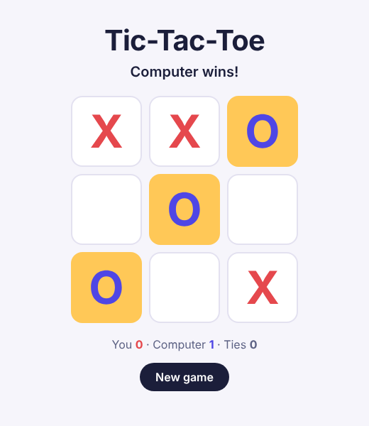

# Tic-Tac-Toe vs. the Computer

Play tic-tac-toe in the browser against a computer that takes wins, blocks yours and plays the center. It highlights the winning line and keeps score across games.


**[Play it live](https://ramya036.github.io/tic-tac-toe/)**



## Features

- You play **X**, the computer answers as **O** a moment later
- The computer **takes a winning move**, otherwise **blocks yours**, otherwise prefers the center and corners
- **Winning line highlighted**, and a running score of wins, losses and ties
- Squares that are taken, and the whole board after a win, can't be clicked
- Keyboard and screen-reader friendly: each square is labeled with its row, column and mark

## How it works

```
src/
├── gameLogic.js   pure rules: getWinner, getWinningLine, computerMove  (no React)
├── Game.js        state: the board and score; whose turn it is is derived from the board
├── GameGrid.js    3×3 grid
└── Square.js      one square
```

The board is the only game state. Whose turn it is and who has won are **computed from the board on every render**, so they can never fall out of sync. An earlier version stored them separately and checked for a winner before the latest move was saved, which meant a win showed up one move late. The computer's move runs in a `useEffect` with a short delay, and the timer is cleared if the game changes first.

## Run it

```bash
git clone https://github.com/ramya036/tic-tac-toe-react.git
cd tic-tac-toe-react
npm install
npm start
```

Open http://localhost:3000.

## Tests

```bash
npm test
```

13 tests: the rules (rows, columns, diagonals, ties, a win on the last square) and the computer's strategy, plus full games through the UI with React Testing Library, covering turns, blocking, winning, the score and starting a new game. GitHub Actions runs the tests and a production build on every push.

## Project structure

| File | Description |
|---|---|
| `src/gameLogic.js` | Game rules and computer strategy |
| `src/Game.js`, `src/GameGrid.js`, `src/Square.js` | React components |
| `src/*.test.js` | Jest and React Testing Library tests |
| `public/styles.css` | Styles |
| `docs/game.png` | Screenshot |
